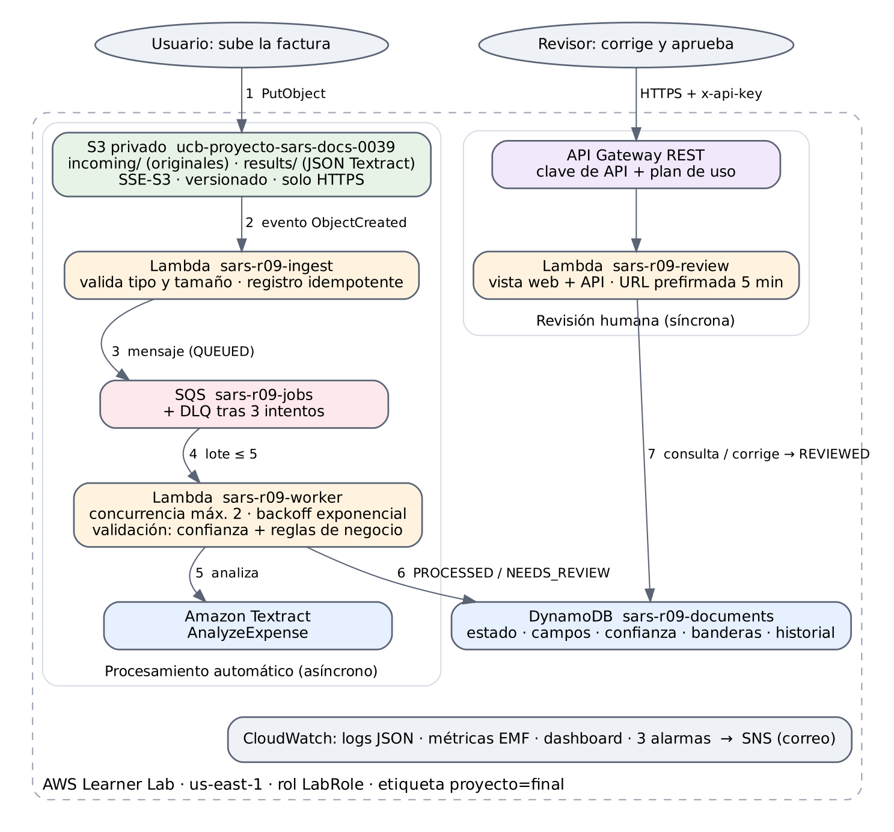

<p align="center">
  <picture>
    <source media="(prefers-color-scheme: dark)" srcset="docs/img/ucb-escudo-blanco.png">
    
  </picture>
</p>

<h1 align="center">PF R09 · Procesamiento inteligente de documentos en AWS</h1>

<p align="center">
  Maestría en Ciencia de Datos e Inteligencia Artificial · Módulo 11 · Computación en la Nube con AWS<br>
  <b>Simon Alex Rodríguez Saavedra</b> · simon.rodriguez.s@ucb.edu.bo · Código de entrega <b>R09</b> · Docente: Fabrizio Bellido
</p>

<p align="center">
  <a href="https://github.com/SimonLexRS/PF_R09_IDP/actions/workflows/ci.yml"></a>
  
  
  
</p>

---

## 1. Problema

Un área contable transcribe a mano facturas escaneadas, en PDF o fotografiadas: es lento y produce errores.
Este servicio **lee cada factura con Amazon Textract**, extrae sus campos clave (N.º de factura, fecha, proveedor,
NIT, subtotal, descuento, total e ítems), mide la confianza de cada uno, **valida** que los datos tengan sentido
(montos que cuadran, fechas válidas, NIT con formato correcto, facturas no repetidas) y envía a
**revisión humana solo lo dudoso**.

> **Prueba de aceptación del reto 09:** procesar documentos de ejemplo, mostrar los campos extraídos y marcar los que requieren corrección.

## 2. Arquitectura

<p align="center">
  
</p>

| # | Servicio | Función | Alternativa descartada |
|---|---|---|---|
| 1 | **Amazon S3** (privado) | Recibe las facturas en `incoming/` y guarda la respuesta de Textract en `results/` | EFS/EBS: no emiten eventos por archivo |
| 2 | **Lambda ingest** | Valida tipo y tamaño, registra el documento (idempotente) y lo encola | Validar después: se pagaría Textract por archivos inválidos |
| 3 | **Amazon SQS + DLQ** | Desacopla y absorbe picos; reintenta fallos transitorios; DLQ tras 3 intentos | Llamar Textract directo: supera la cuota TPS, sin reintento controlado |
| 4 | **Lambda worker** | Llama a Textract, normaliza, valida y guarda el resultado | EC2 encendida 24/7: costo fijo |
| 5 | **Amazon Textract** | `AnalyzeExpense`: campos de factura con confianza + OCR por palabra | Tesseract: sin semántica de campos ni confianza |
| 6 | **Amazon DynamoDB** | Estado, campos, banderas e historial por documento | RDS: servidor permanente y esquema rígido |
| 7 | **API Gateway + Lambda review** | Vista web de revisión, protegida con clave de API y límite de uso | URL de Lambda: sin clave ni límites |
| — | **CloudWatch + SNS** | Logs, métricas, panel y 3 alarmas con aviso por correo | Solo logs: no avisan |

**Estados de un documento:** `QUEUED → PROCESSING → PROCESSED | NEEDS_REVIEW → REVIEWED` · errores: `REJECTED`, `RETRYING`, `FAILED`.

**Regla de confianza:** un campo se acepta con confianza ≥ 90 %; entre 70 y 90 % solo si una regla de negocio lo
confirma (`CORROBORATED`) o si el OCR leyó exactamente ese valor con ≥ 90 % (`OCR_VERIFIED`); si no, va a revisión.

## 3. Cómo reproducirlo

**Requisitos:** una sesión activa del **AWS Academy Learner Lab** (región `us-east-1`, rol `LabRole`).
No hace falta instalar nada: todo se ejecuta en **AWS CloudShell**, que ya trae AWS CLI, Python y boto3.

```bash
# 1. En la consola de AWS (us-east-1) abrir CloudShell y descargar el proyecto
git clone https://github.com/SimonLexRS/PF_R09_IDP.git
cd PF_R09_IDP

# 2. Desplegar toda la infraestructura (≈ 3 min). El correo es opcional, para recibir alarmas.
ALERT_EMAIL=tu_correo@ucb.edu.bo ./scripts/deploy.sh

# 3. Ejecutar la prueba de aceptación (sube las 6 facturas de datos/muestras/ y compara con lo esperado)
python3 scripts/prueba_aceptacion.py

# 4. Ejecutar los casos de error (archivo no permitido, archivo grande, PDF corrupto, reintentos y DLQ, API sin clave)
python3 scripts/caso_error.py

# 5. Al terminar: eliminar todos los recursos
./scripts/limpieza.sh
```

- Al final del paso 2 se muestran la **URL de la vista de revisión** y el comando para obtener la **clave de API**,
  que se pega en la vista web.
- Los pasos 3 y 4 imprimen una tabla ✅/❌ y guardan el resultado con fecha en [`evidencias/`](evidencias/).
- Para probar a mano: subir cualquier factura desde la vista web, o con `aws s3 cp factura.png s3://<bucket>/incoming/`.

> [!IMPORTANT]
> Si se reinicia la sesión del Learner Lab, revisar que el desencadenador SQS de la Lambda **sars-r09-worker**
> esté **Enabled** (Lambda → Configuración → Desencadenadores). Si está deshabilitado, los documentos se quedan en `QUEUED`.

<details>
<summary><b>Alternativa: desplegar solo con la consola web (sin terminal)</b> — método usado en este proyecto</summary>

1. Comprimir el contenido de `src/` en un ZIP (`*.py` y `ui.html` en la raíz del ZIP).
2. **S3 → Crear bucket** privado (p. ej. `ucb-proyecto-sars-0039`) y subir el ZIP.
3. **CloudFormation → Crear pila → Cargar plantilla** [`infra/template-console.yaml`](infra/template-console.yaml).
   Parámetros: `CodeBucket` (el bucket del paso 2), `CodeKey` (nombre del ZIP), `DocsBucketName`
   (p. ej. `ucb-proyecto-sars-docs-0039`), `AlertEmail` (opcional). Etiqueta `proyecto=final`. Sin rol de servicio.
4. Esperar `CREATE_COMPLETE`. En **Salidas** abrir `ReviewUiUrl`; la clave está en
   **API Gateway → Claves de API → sars-r09-revisor → Mostrar**.
5. Subir las facturas de `datos/muestras/` desde la vista web o a la carpeta `incoming/` del bucket.
6. Limpieza: vaciar los dos buckets y **eliminar la pila** en CloudFormation.

</details>

## 4. Resultados obtenidos en el Learner Lab

**Prueba de aceptación — 6/6 según lo esperado**

| Documento | Esperado | Obtenido | Conf. media | Motivo |
|---|---|---|---|---|
| 01_factura_limpia.png | PROCESSED | PROCESSED ✅ | 93,4 % | Sin banderas (NIT `OCR_VERIFIED`) |
| 02_factura_limpia.pdf | PROCESSED | PROCESSED ✅ | 94,3 % | Sin banderas |
| 03_factura_baja_calidad.jpg | NEEDS_REVIEW | NEEDS_REVIEW ✅ | 99,6 % | `TOTAL_MISMATCH` |
| 04_factura_total_inconsistente.png | NEEDS_REVIEW | NEEDS_REVIEW ✅ | 96,9 % | `TOTAL_MISMATCH` (298,00 vs 356,00) |
| 05_factura_duplicada.png | NEEDS_REVIEW | NEEDS_REVIEW ✅ | 95,7 % | `DUPLICATE` (mismo NIT y N.º que la 01) |
| 06_factura_sin_numero.png | NEEDS_REVIEW | NEEDS_REVIEW ✅ | 94,5 % | `MISSING` numero_factura |

Textract: 1,8 – 3,3 s por página · de la subida al estado final: 3,6 – 8,3 s.

**Casos de error — 6/6 según lo esperado**

| Caso | Entrada | Resultado |
|---|---|---|
| E1 | `e1_documento.txt` | `REJECTED` en la ingesta (extensión no permitida); no llega a Textract |
| E2 | `e2_grande_6mb.png` | `REJECTED`: supera el máximo de 5 MB |
| E3 | `e2_corrupto.pdf` | `FAILED` permanente (`UnsupportedDocumentException`), sin reintentos |
| E4 | `chaos-e4_reintentos.png` | 3 intentos → `FAILED` → DLQ; alarma en ALARM a los ≈ 38 s y aviso por SNS |
| E5 | API sin clave | HTTP 403 |
| E6 | Corrección con fecha `31/02/2026` | HTTP 400; el documento no cambia |

Detalle con horas y valores: [`evidencias/resultados_learner_lab_2026-10-23.md`](evidencias/resultados_learner_lab_2026-10-23.md).

## 5. Pruebas automáticas (sin AWS)

```bash
pip install -r requirements-dev.txt
pytest -q        # 27 pruebas: extracción, validación y flujo completo con AWS simulado (moto)
```

GitHub Actions las ejecuta en cada push junto con `cfn-lint` de las plantillas ([`ci.yml`](.github/workflows/ci.yml)).

## 6. Seguridad y costo

- **Sin credenciales en el repositorio:** las Lambdas usan el rol `LabRole`; la clave de API solo se ingresa en el navegador.
- **Datos privados:** bucket con acceso público bloqueado, cifrado y solo HTTPS; originales mostrados con URL temporales de 5 min.
- **API protegida:** clave de API y plan de uso (5 solicitudes/s, 5.000/día).
- **Costo:** todo serverless y bajo demanda; Textract ≈ USD 0,01 por página → **menos de USD 1** en todo el proyecto.
- Todos los recursos llevan la etiqueta `proyecto=final`.

## 7. Estructura del repositorio

```
infra/       Plantillas CloudFormation: template.yaml (CloudShell) y template-console.yaml (consola web)
src/         Código de las Lambdas ingest, worker y review + vista web de revisión (ui.html)
scripts/     deploy.sh · prueba_aceptacion.py · caso_error.py · limpieza.sh · generar_facturas.py
tests/       Pruebas pytest + moto (incluye una respuesta real de Textract)
docs/        Diagrama de arquitectura (PNG, SVG y fuente .dot)
datos/       Facturas sintéticas: muestras/ (prueba de aceptación) y errores/ (casos de error)
evidencias/  Resultados con fecha de las pruebas en el Learner Lab
```

---

<sub>Todas las facturas son sintéticas, de empresas ficticias y sin valor fiscal (generadas con `scripts/generar_facturas.py`).
Proyecto académico · Universidad Católica Boliviana «San Pablo» · 2026.</sub>
